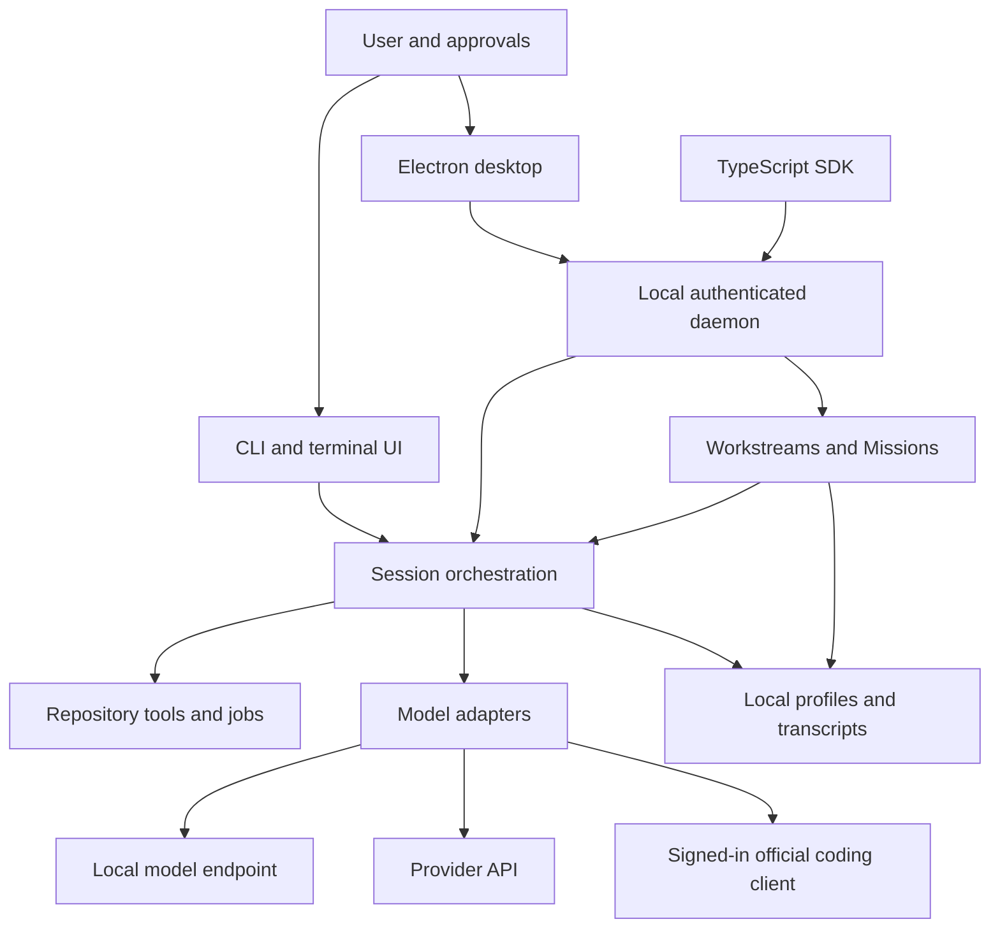
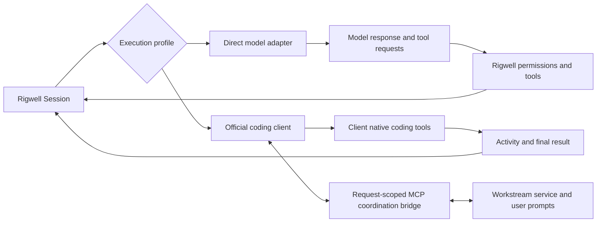
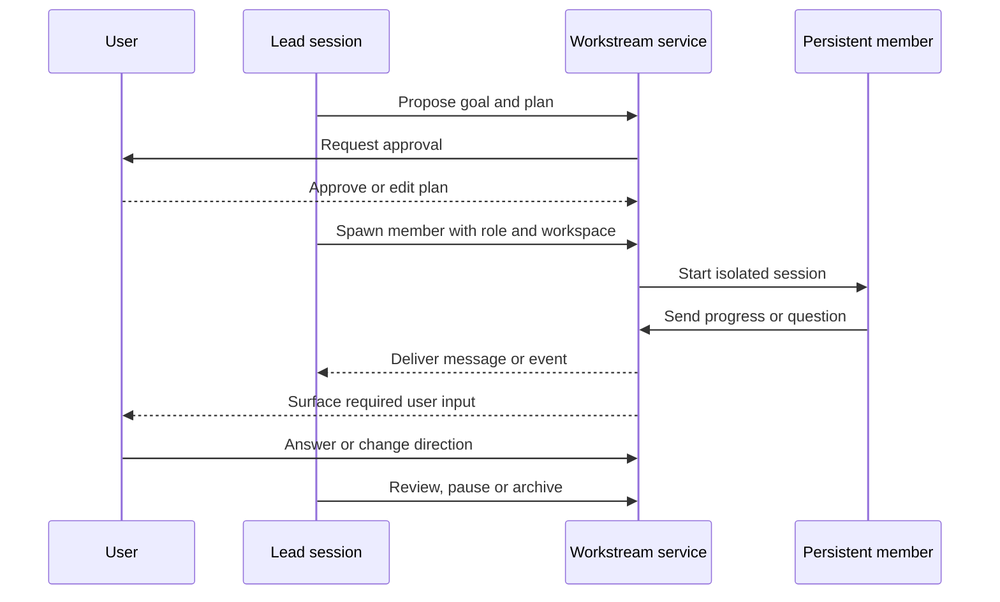
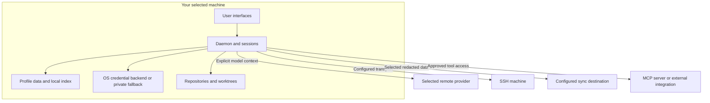

# Rigwell user manual

For Windows **0.5.0**, with Linux and macOS distributions remaining at **0.4.0**. See [0.5.0 release notes](release-0.5.0.md) for fixes and verification. Rigwell is a local workspace for AI-assisted coding: a desktop app, terminal interface and agent service, with persistent Workstreams, Missions, repository tools and review. You choose the model connection. Your machine runs the coordination service; a cloud model still receives the context sent to it.

This manual covers first use, everyday work, nontechnical review, technical operation and architecture. Feature-specific reference guides are linked where more configuration detail is useful.

**Workstream review recovery.** When a member runs out of output before a tool call, Rigwell asks it to take the next concrete action. A repeated cap before tool progress marks the turn failed and can wake the lead.

**Workstream Next handoffs.** In 0.4.2, a signed-in lead waiting in a Rigwell coordination tool receives the full message body with the event. See [Workstream timing and recovery](workstreams.md#limits-and-recovery) for what happens when a client is using its own tools.

## Choose your starting point

| You want to... | Start here |
| --- | --- |
| Install Rigwell and complete a first task | [New-user guide](#new-user-guide) |
| Review work without learning the command line | [Nontechnical-user guide](#nontechnical-user-guide) |
| Coordinate multiple coding agents | [Workstreams](#workstreams) |
| Run a planned, staged body of work | [Missions](#missions) |
| Use the terminal, SDK or configuration files | [Technical-user guide](#technical-user-guide) |
| Understand the components and trust boundaries | [Architecture](#architecture) |
| Recover from a problem | [Troubleshooting and recovery](#troubleshooting-and-recovery) |

## New-user guide

### What you need

Use a supported Windows, Linux or macOS computer, a folder containing your project, and access to a model. Git and ripgrep support repository and search tools. Desktop installers carry Rigwell's runtime; opening the installed app does not require separately installing Bun or Node.

Choose one model connection:

- **A signed-in official coding client:** Rigwell can use installed Anthropic or OpenAI coding clients. Sign in through the official client first. The client owns subscription authentication, refresh and native coding tools; Rigwell manages sessions and coordination. Availability depends on the account and provider.
- **A direct API:** configure a supported provider and its credential. API usage can be billed separately from a chat subscription.
- **A local endpoint:** run a compatible local Chat Completions server and select an installed model. Your computer must have enough memory for that model and the project tools.

Do not paste credentials into a chat or a repository file. Use Settings and the credential store. See [account and model connections](auth.md) for the exact connection formats and native-client permission differences.

### Install and open

Download the [signed Windows 0.5.0 installer](https://github.com/scottconverse/rigwell/releases/download/v0.5.0/rigwell-setup-0.5.0-x64.exe), or choose a Linux/macOS package from [0.4.0](https://github.com/scottconverse/rigwell/releases/tag/v0.4.0). Keep the release's checksum information with the installer.

| Platform | Installation | Current release qualification |
| --- | --- | --- |
| Windows x64, 0.5.0 | Run the setup executable. Choose the installation location, then open Rigwell from its shortcut. | Verify the Scott Converse signature and timestamp. The release assets include the signing receipt and the clean-runner installation record. |
| Linux x64, 0.4.0 | Install the Debian package, or make the AppImage executable and open it. | Installed package checks and signed AppImage update/rollback have passed on disposable Linux runners. |
| macOS arm64, 0.4.0 | Open the DMG and copy Rigwell.app to Applications. | Current artifacts are unsigned and not notarized. Installed runner checks passed; real Mac hardware acceptance remains unavailable. |

For Windows, use Properties > Digital Signatures to check the publisher. For Linux AppImage updates, Rigwell checks the release signature before installation. macOS users should read the unsigned-artifact limitations before choosing to install. See the [installation guide](install.md) for platform details and rollback instructions.

### Connect your model

1. Open Rigwell. An empty profile displays **Connect a model**.
2. Choose **Configure a model**. In Settings, add a custom model using the connection you intend to use.
3. For a supported subscription-client profile, select **Signed-in official client** and choose the matching provider. The client must already be installed and signed in. A custom executable path is available when automatic discovery does not find it.
4. For an API or local server, enter the provider, model identifier and endpoint where required. Keep credentials in the credential store or an environment reference.
5. Save the profile, return to the workspace and select it for your session.

Model identifiers are supplied by your provider or local server. Rigwell does not grant access to a model merely because a profile can be saved. A sign-in option without a registered client is shown as unavailable; use an existing official-client profile or a supported direct connection rather than guessing another application's client ID.

### Check your session profile and effort

Before sending a task, check the model profile below the message box. Select the intended profile in the composer and check the adjacent **Reasoning** control if the task specifies an effort level. A model name in the prompt describes a requirement for the agent to follow. The composer selection controls which profile executes the turn.

For future sessions, change **Model** in **Settings > Session Defaults**. For the current session, use its composer. Use **Tab** and **Shift+Tab** to move between controls. In the desktop composer, **Ctrl+Alt+M** toggles Spec mode and **Ctrl+Alt+R** cycles reasoning effort.

If work has already started on the wrong profile, interrupt the turn and wait for it to become idle. Check what it already did, then select the intended profile and effort before sending another request. For a clean Workstream run, start a fresh session if the first attempt already created a proposal or changed the workspace.

### Open a project safely

Choose the project folder before starting work. A Git repository is preferable because it makes changes and recovery easier to inspect. Save or commit work you want to preserve before a broad editing task.

Rigwell can ask whether you trust a folder. Trust permits project-controlled instructions, settings, hooks and extensions to load. Trust repositories you know; inspect unfamiliar repositories before enabling their executable configuration. Folder trust is separate from approval of an individual edit or command.

### Complete your first task

Start with a small, observable request:

> Read this project and explain how to run its tests. Do not edit files yet.

Read the response and check its file references. Then ask for a bounded change:

> Fix the validation error in this form. Keep the public behavior unchanged, add an appropriate regression check, and show me the diff and test result.

Use planning/spec mode when you want a plan first. Keep autonomy conservative until you understand the repository and model connection. Review permission requests before accepting them: check the target folder, command and likely effect. Answer questions in the prompt panel so the agent can continue.

When the turn finishes, inspect the changed files, run results and remaining limitations. A confident answer is not proof that a build or test ran. Open Review to inspect the actual changes before committing or publishing.

## Nontechnical-user guide

You can describe an outcome and review results without writing shell commands. You still decide what the agent may change and whether the result is acceptable. Work with a repository owner when a request involves credentials, deployment or important data.

### Describe the result, not just the activity

A useful request identifies the problem, the desired behavior and how you will recognize success. For example:

> On the contact form, submitting an empty email currently shows an unclear error. Make the message explain what to enter. Show the exact text before changing it, then demonstrate the result and report any checks you could not run.

For a larger task, ask for a plan with checkpoints. State whether the agent may edit, run commands, contact an external service or publish. If you only want an explanation, say so.

### Understand requests for approval

- **Trust:** allows project configuration and instructions to participate in the session.
- **Permission:** approves a particular operation or permission scope. Read the operation rather than accepting by habit.
- **Question:** asks you to choose behavior or supply missing information.
- **Workstream or Mission proposal:** approves a plan for coordinated work. Read the goal, steps, workspace and limits.
- **Push, pull request or review submission:** writes to a remote service. Check the branch, destination and text before confirming.

Cancel when the operation differs from what you intended. Clarify the task in the conversation. Higher autonomy permits more actions without individual prompts; it does not establish that the agent's choices are correct. Subscription clients use their own native tool permissions, which differ from direct-adapter execution. In 0.4.2, unresolved Claude command approvals reach Rigwell's permission panel with the workspace and requested operation. Choose allow once or cancel; this does not change global client permissions. A native deny rule still applies. See [native permissions](auth.md#signed-in-coding-clients).

### Review without reading every line of code

Ask for a plain-language change summary, screenshots or reproducible steps where relevant, the tests actually run and the known limitations. In Review, look for unexpected files, unrelated changes, credentials and changed configuration. Ask the agent to explain anything you do not recognize. For code correctness, obtain appropriate technical review rather than relying only on the model's self-assessment.

You can interrupt an active turn. Saved sessions can be resumed later. A stopped turn may already have changed files; inspect the workspace before retrying. Never assume interruption rolls changes back.

## Everyday workspace

The list pages (Mission Control, Workstreams, Inbox, Analytics, Academy, Wiki, Review, Automations) now use cards, pill-shaped status badges and underline tabs.

Menus, dialogs and the command palette (Ctrl+K) have a new look; they work the same way.

### Sessions, files and terminal

The Home screen shows the Rigwell mark and asks **What should we work on?** (in mission mode, **What should the mission do?**). Type your request in the message box. The machine, folder and **Worktree** choices are now under the message box, so you pick where the work happens right below where you describe it.

The sidebar shows `New Session`, `Automations`, `Search` and `Mission Control`. `More` opens the other pages: Inbox, Workstreams, Review, Machines, Import session, Sync, Plugins, Wiki, Analytics and Evaluations. `Search` (`Ctrl+K`) finds every page, every Settings page and your sessions. Below the buttons the sidebar has three sections: `Pinned` (when you have pinned sessions), `Workstreams` (Beta) and `Projects`. `Pinned` lists the sessions you pinned so you can find them quickly. `Workstreams` lists the Workstreams that are running or paused. `Projects` groups your sessions by folder; click a folder name to fold or unfold it, and use its `+` to start a session there. The `Filter projects` button (three dots) opens the sidebar filters for last activity, project and grouping. `Add folder` (the folder button) adds a project folder. The buttons at the top of the window go `Back`, go `Forward`, and hide or show the sidebar. Rigwell remembers the sidebar choice the next time it starts. The gear button at the bottom of the sidebar opens Settings. In Settings, type in `Find a setting` to find a page by its name or by an option on it, such as `theme` or `tokens`. Settings that are on or off are now switches: click the switch to turn the setting on or off. The Appearance page shows three theme cards, System, Light and Dark; click a card to pick the theme.

A session records a conversation and its activity in a selected working folder. Use clear tasks and continue the same session when its context is relevant. Resume an existing session rather than repeating its work blindly; fork when you want an independent conversation based on an earlier one.

Send and Stop are now icon buttons in the message box; they are in the same place and use the same keys. The Tools panel and session menu buttons are icons at the top right of the session.

The side pane provides files, a terminal, browser, side chat and agents. Use Files to inspect the current folder and Review to compare changes. A terminal command runs real code with the selected machine's permissions. Inspect command effects before authorizing installation, deletion or deployment.

The `Agents` tab lists the Workstream members and Mission workers of the session. Each row shows the full name, the status, the current step and the running time. Click `Details` to see the tokens, cost, branch and allowed files.

Each session in the sidebar shows `Working`, `Waiting for you` or `Idle`. A pinned session shows a pin icon. When a Workstream runs or is paused, it shows in the `Workstreams` section; when none are running, that section says `No workstreams running`. Click a Workstream to open it. Archived and finished Workstreams do not show there.

When the model asks a question or needs approval, use the prompt controls in the session. Inbox and Workstream attention can help find work waiting on you. The displayed activity and transcript are evidence of reported execution; use actual files, command output and external readbacks to confirm results.

Two or more tool calls in a row fold into one line, such as `Activity · 31 events`. Click the line to open or close the list. A group stays open while one of its tools runs, and when a tool fails. During a turn, the status line names the current step, such as `Running 1 command` or `Making 1 file change`.

You can send a message while the agent works. The message goes to a `Waiting` list above the input, and moves into the transcript when the agent takes it. Press `Enter` to add it to the end of the list. Press `Ctrl+Enter` to deliver it after the current tool step. Neither key stops the agent. Only `Stop` or `Esc` stops it. A stop ends the current turn only, so the agent then takes the next waiting message.

When your last message scrolls out of view, a copy stays at the top of the transcript. Click it to jump back to the message. The transcript also shows a time line, such as `Today 2:14 PM`, after 30 minutes without activity or when the day changes. Older sessions that have no stored time show no time line.

### Workstreams

To start a Workstream from a template, click `+` next to `Workstreams` in the sidebar. Pick your role and a template, or `Or begin with a blank workstream`. Give it a name, choose the working folder, and click `Create workstream`. Rigwell opens a new session with the first message filled in. Click Send. The lead session proposes the plan, and no member starts before you approve it.

See the [Workstreams reference](workstreams.md) for member controls, delivery priorities, budgets and recovery.

A Workstream is persistent coordination around a goal. A lead session can propose a plan, then manage reusable member sessions, messages, listeners and shared progress. Members can use isolated Git worktrees so separate tasks have separate branches and files.

1. Ask the lead for a Workstream with a specific goal, member roles, acceptance checks and budget.
2. Review the proposal. Reject or edit it when the scope is wrong. Members must not start from an unapproved proposal.
3. Open **Workstreams** to inspect the roster, member state and messages. Open a member transcript for detail.
4. Use **Message** to give direction. Delivery priority controls when a message is offered; an active member may need to reach a turn boundary.
5. Answer member questions and permission prompts. Pause or interrupt when you need control back.
6. Review each member's branch and checks before integrating its work. Archiving is a separate action; review any cleanup confirmation.

If you reload or reconnect a session view while its Workstream proposal is waiting, 0.4.2 restores that pending prompt while the daemon and session remain alive. Open the same session and answer the restored proposal instead of submitting another request. Cancelling a proposal prevents a late answer from creating it. An interrupted or restarted daemon can end an in-flight proposal; saved Workstreams and members have their own recovery lifecycle.

For subscription-client members, Rigwell carries native coordination call/result receipts into subsequent invocations so the lead can retain member identities and handoffs. Members still need explicit roles, file ownership and integration checks.

Token, cost and wall-time limits can pause further work. Cost may be unpriced for subscription or local execution; a zero or absent estimate is not a measured monetary charge. A Workstream coordinates agents, but does not guarantee conflict-free code or an accepted pull request.

Example request:

> Propose a Workstream to improve the onboarding guide. Use one writer and one verifier in separate worktrees. The verifier should check commands and links. Bring both results back for review, and do not push.

For a Workstream with a required lead profile, [check the lead profile and reasoning level](#check-your-session-profile-and-effort) before requesting a proposal. Review the member profile IDs and worktree assignments in the proposed plan before accepting it, then confirm the active profiles in the roster.

The workstream page has a Shared files section. It lists each file in the shared folder with its version and who saved it last. Open a file to see every version, view an old version, or restore it. A restore adds a new version. See [Shared file history](workstreams.md#shared-file-history).

### Missions

Use a Mission for a larger plan with staged execution and validation. Review the proposed features, boundaries and checks before starting. Mission readiness reports can identify missing tools or unrun checks; a readiness warning is not proof of failure or success.

During execution, inspect progress, questions and validation results. Use handoff information to understand unresolved work. A paused or interrupted mission is incomplete until its remaining outcomes are verified. Resume deliberately after reviewing the working directory. See [mission readiness](mission-readiness.md).

#### Run workers at the same time

Open `Settings > Missions` and set `Workers at once` from 1 to 4. The default is 1. With 1, a mission works in your folder, one feature at a time. A remote machine always runs 1 worker.

Above 1, each worker gets its own code copy (a git worktree). Rigwell runs two features together only when neither depends on the other (`dependsOn`) and their file areas (`fileAreas`) do not overlap. A feature with no file areas runs alone. Each worker must commit its work.

Rigwell merges finished features one at a time into a separate branch named `rigwell/mission-<id>`. Your own branch does not change. When the mission completes, review that branch and merge it yourself. Validators run alone, on the merged code. After a worker's work is merged, Rigwell removes that worker's worktree and branch. It never removes one that still has uncommitted or unmerged work.

If a merge has a conflict, Rigwell stops that feature, keeps its branch, and asks for your attention. Rigwell never resolves a conflict silently. If one worker has a problem, the running workers finish their current feature, no new worker starts, and the mission asks for your attention. `Pause` stops all workers at once.

Spend limits apply to every worker. Rigwell checks the limit before each model request, but a request already running can finish above it. With 4 workers, up to 4 requests can finish above the limit.

### Branches, review and pull requests

Use an isolated worktree for work that should not disturb an existing checkout. Review tracks the actual repository snapshot. A changed head may require reloading the review before submitting it.

Creating a PR requires confirmation of the branch, base, title and body before any push. Canceling that approval does not push. Rigwell can display PR state and checks; worktrees with an open PR are excluded from automatic branch cleanup. Remote review comments and approval actions also require confirmation. See [review](review.md).

### Automations, Inbox and delegation

Automations run a saved task using its configured folder, schedule, model and permissions. The Automations page opens with a banner that explains what automations are for, followed by a **Start from a template** section with a card for each ready-made template. Click a card to set that template up. Creating an automation does not itself prove a run occurred. Review the saved instructions and schedule, then inspect run history. Pause unwanted work rather than deleting its recovery evidence.

The templates dialog has 16 ready-made templates. They report only: they do not change files, post messages or open pull requests. Templates that use a connector need that connector's tools set to always allow for the folder, because unattended runs cannot ask.

The templates dialog also has a `CI workflows` tab: Pull Request Review, QA Checks, Docs Refresh and Security Sweep. Choosing one opens a new session with the setup message filled in. The agent sets up the job as a local automation; it runs on this computer while the Rigwell service runs, not in GitHub Actions. Nothing is installed until you approve it.

Local event triggers can accept configured GitHub/CI, Slack and chained events. Slack and Teams delegation require the respective service registrations and credentials. They do not become operational solely because the feature exists in Rigwell. Inbox records events and routes you to the associated work. Email alerts require explicitly configured SMTP. See [automations](automations.md), [event triggers](automation-triggers.md), [delegation](delegation.md) and [Inbox](inbox.md).

### Models, connectors and plugins

Select the model appropriate to the task and your data requirements. A local endpoint keeps inference on the machine you configure; a remote endpoint receives model context. Changing a model may change cost, speed, tool behavior and account limits.

Connectors add external tools and resources through MCP. Review a server's origin, requested credentials and access before connecting. OAuth setup is server-dependent. The catalog supplies configuration; it is not an assurance that every listed server is safe or currently available. Plugins can add skills and configuration; inspect their source and permissions. Until setup is complete, the sidebar shows a Finish setup card with the next step: connect a model, start your first session in a project folder, then connect your tools. The card hides when all three are done. See [connectors](connectors.md) and [plugins](plugins.md).

### Knowledge, learning and evaluations

Wiki tools build and search local project knowledge. Academy provides local tutorials and practice checks. Analytics reads locally recorded usage; unpriced execution remains unpriced. The Analytics page also shows four badges (First Steps, Regular, Long Haul, Weekend Builder). They count your own sessions on this machine, not automation runs, subagents, forks, workstream members, mission workers or evaluation trials. Time is active time; a pause of more than 30 minutes ends a stretch. Settings > Usage shows bars for your daily and monthly spend limits and, where a provider reports them, its request and token limits with reset times in local time. A provider that reports nothing shows "Not available from this provider"; Rigwell never estimates these limits. Local review, triage and QA services use ordinary session and automation engines.

Evaluations displays saved runs, per-task evidence and same-task outputs side by side. Import CSV/JSONL datasets, then explicitly start trials through the CLI. A rubric requires a selected judge; a failed command check still fails overall. The current Stax option is explicitly mapped CSV conversion with unverified export compatibility. A hosted Stax option is next-version work. See [evaluations](evaluations.md), [wiki](wiki.md), [Academy](academy.md), [Analytics](analytics.md) and [local services](local-services.md).

### Other machines, sync and phone access

Machines uses configured SSH access and a bootstrapped remote Rigwell service. Verify the host identity and selected working folder before running work. Fleet controls can update, restart or stop those services. Real remote-host acceptance depends on your network and credentials.

Sync is off until configured. Select a private Git remote or supported shared folder and the data types to transfer. Sync does not transfer repository checkouts, credentials or native-client logins. Imported work stays inactive until explicitly restored; examine copies and backups before handing off ownership.

Phone access is opt-in. It uses a selected network interface, certificate identity and one-time pairing. Treat a pairing code as access to the configured service, verify the identity and revoke devices you no longer use. Network reachability and physical-device notification behavior depend on your setup. See [machines](machines.md), [sync](sync.md), [sharing](sharing.md) and [phone access](phone.md).

## Technical-user guide

### Run from source

Use Bun 1.4.4, Git and ripgrep. Desktop development additionally uses Node 22 and its npm dependencies. Packaged desktop installation is a separate path and does not automatically make a global `rigwell` CLI command available.

```powershell
git clone https://github.com/scottconverse/rigwell.git
cd rigwell
bun install
bun src/cli/main.ts --help
bun src/cli/main.ts eval tasks
```

From the source checkout, prefix the following CLI examples with `bun src/cli/main.ts` in place of `rigwell`. Examples using `rigwell` assume you have installed or linked the CLI yourself. See [desktop development](desktop.md) for starting Electron from source.

### CLI and TUI essentials

```text
rigwell --cwd <repository>
rigwell exec --cwd <repository> "Explain the test setup without changing files"
rigwell exec --cwd <repository> --auto low "Fix the failing validation test"
rigwell exec --cwd <repository> --use-spec "Plan the settings migration"
rigwell exec --cwd <repository> --resume
rigwell exec --cwd <repository> --resume <session-id> "Continue the remaining checks"
rigwell exec --cwd <repository> --fork <session-id> "Explore another approach"
rigwell daemon --no-automations
```

The interactive terminal UI is the default command. Use `/help` for the available commands, `/review` for review and `/pr` for PR state/actions. The CLI help documents explicit machine, model, autonomy, trust and transport options. Do not enable unsafe permission skipping as a routine setup step.

### Configuration and credentials

Default data lives under `~/.rigwell`; `RIGWELL_HOME` selects an explicit home. `settings.json` contains model profiles and agent defaults. Project configuration is loaded according to trust rules. Use named local profiles to separate projects or roles without copying credentials.

```text
rigwell profile create work "Work"
rigwell --profile work auth status
rigwell credential set <credential-name>
rigwell credential delete <credential-name>
```

The credential-set command reads the value from stdin. Avoid a secret literal in shell history. API profiles can refer to `keychain:<name>` or supported environment references. Windows uses current-user Credential Manager where supported and an owner-private fallback when required. Native-client subscriptions keep their credentials in their own official-client stores.

Generic OAuth flows support registered clients, PKCE/device flow where offered, refresh and sign-out. A working OAuth implementation is not an app registration or provider entitlement. See [authentication](auth.md), [local profiles](local-profiles.md), [policy](policy.md), [spend limits](spend-limits.md) and [fallback models](fallback-models.md).

### Evaluation and qualification

```text
rigwell eval tasks
rigwell eval run --task <task-name> --model <profile-id>
rigwell eval compare --config <private-comparison-config.json>
rigwell eval history
rigwell eval report --since 7d
rigwell eval export --run <run-id> --format jsonl --out <results.jsonl>
```

Task folders contain a prompt, fresh repository fixture, budget and grader. Comparisons require explicit equivalent profile mappings and three trials per side. Keep task contracts, model choice, effort and budgets stable during a comparison. Retain failures and distinguish fake-service checks, real model execution, installed behavior and final delivery.

Rubric judges are optional and use a separate model selection. Their tokens and cost are recorded separately. Subscription/local totals are not cash prices unless pricing is explicitly supplied. Current release evidence does not establish universal model-family quality or every account's entitlements. See [eval engine](eval.md) and [Evaluations](evaluations.md).

### SDK and protocol

The TypeScript SDK exposes session creation, execution, cancellation and daemon connections. NDJSON JSON-RPC uses the `rigwell.` method prefix. Desktop clients use a preload boundary and authenticated loopback daemon connections; direct process clients can use stdio.

Implement request handlers for real user approval and questions when building a client. A client without an approver must not manufacture user approval. Handle disconnects, cancellation, partial file changes and terminal outcomes. Do not replay native coding invocations automatically after an uncertain failure. See [clients and SDK](clients.md) and the protocol specification.

### Backup, restore and upgrades

Pause work before copying its data. Back up repositories and Rigwell profile data separately. Repositories contain code and branches; the profile contains sessions, definitions and other coordination data. Credential stores and official-client logins require their own recovery mechanisms and are not portable just because a profile folder is copied.

When a new version is available, an `Update available` button shows at the top right of the window. Click it to download. The button shows `Downloading`, then `Restart to install`. Rigwell installs only after you click `Restart to install`. If the button shows `Update failed` or `Update refused`, point to it to read the reason, or click it to try again. File > Check for Updates runs the same steps.

Keep the previous installer and a profile backup before upgrading. A binary rollback does not undo data migrations or agent edits. Linux AppImage rollback restores the retained previous application after confirmation. Windows rollback reinstalls a retained signed installer; inspect the profile before resuming work. See [release updates](release-updates.md).

## Architecture

### System components



Desktop is a user interface over the same local services used by other clients. It includes a bundled Bun runtime for the daemon. A Session owns conversation state, turn lifecycle, tool coordination and usage. Workstreams and Missions persist their own plans and worker state. Repositories remain ordinary files and Git worktrees.

### Direct and subscription execution



With a direct adapter, Rigwell executes its tool loop and applies its per-tool gates. With a signed-in client, the client executes native coding tools under its own permissions; Rigwell records activity and coordinates the session. The temporary MCP bridge exposes selected coordination tools, not an unrestricted daemon administration interface. Policies requiring Rigwell-only per-tool enforcement can refuse a native backend.

### Workstream lifecycle



Approval creates the coordination scope; it does not make every later action universally authorized. Members remain attributable to their actor and session. A lead can coordinate messages and wait for events while user questions remain under user control. Pending service approval requests participate in the Session prompt registry and can be answered after view reattachment while that Session is alive. Native request history includes coordination receipts for the owning native backend.

### Storage and trust boundaries



Local coordination does not mean every workflow is offline. Model requests, configured integrations, sync and SSH can cross machine boundaries. Share/export redaction reduces known secret exposure but cannot recognize every piece of sensitive business data. Review the actual material and destination before sharing.

### Source map

| Area | Main implementation |
| --- | --- |
| Agent loop and prompts | `src/agent/` |
| Provider and native-client execution | `src/adapters/` |
| Protocol and daemon | `src/protocol/`, `src/daemon/`, `src/sdk/` |
| Desktop | `desktop/main/`, `desktop/preload/`, `desktop/renderer/` |
| Persistent coordination | `src/workstreams/`, `src/missions/` |
| Git isolation and PR actions | `src/worktree/`, `src/review/` |
| Execution, permissions and tools | `src/tools/`, `src/permissions/`, `src/jobs/` |
| Settings, credentials and transcripts | `src/storage/` |
| Evaluations and reports | `src/eval/`, `eval/tasks/` |
| Remote, sharing and extensions | `src/machines/`, `src/sync/`, `src/mcp/`, `src/plugins/` |

## Troubleshooting and recovery

| Symptom | What to check | Safe next step |
| --- | --- | --- |
| First run has no models | The active profile and Settings > Custom Models | Configure one connection; do not paste a credential into the conversation |
| Lead reports the wrong model or effort | Model and Reasoning controls below the message box | Interrupt the turn if needed and check its effects. Select the intended profile and effort before sending another request. Use Settings > Session Defaults for future sessions. |
| Official client cannot be found | Its installation and optional absolute executable setting | Run that client's help/auth status locally; correct the path without changing provider or model |
| Authentication or rate limit error | The selected account, provider entitlement and reported error | Reauthenticate through the proper client or wait for the account limit; do not repeatedly retry an uncertain coding action |
| Local model will not load | Server URL, installed model, available RAM/VRAM and other model processes | Free appropriate resources or select a model that fits; preserve unrelated running work |
| A Workstream proposal disappeared after a view reload | Same saved session and daemon state | Reopen the same session in 0.4.2; a still-pending proposal is restored. Check for an existing Workstream before proposing again |
| A native command reports approval is required | Native client deny rules, displayed Rigwell permission panel and account state | Review the exact request and allow once or cancel; do not switch models or enable permission skipping to bypass a refusal |
| A permission prompt is waiting | Session, Inbox and Workstream member prompts | Approve only the intended operation, or cancel and clarify |
| Workstream member appears idle | Its transcript, queued messages, questions and budget | Inspect the reason before resuming or increasing a limit |
| Agent says a check passed but evidence is absent | Actual command output, exit code, files and CI | Request or run the specific missing check; do not treat the summary as a receipt |
| Update or download fails | Exact release asset, checksum, signature and available disk space | Retain the previous app and profile backup; report the precise error |
| App or daemon disconnects | Current process state, selected profile and saved session | Check for still-running work before restarting; resume saved work deliberately |
| Sync has conflicting revisions | Both copies and ownership/lease information | Inspect copies and backups before Restore; do not overwrite the only known-good version |

Use **Report a bug** to create a local diagnostic archive. It is not uploaded automatically. Review it before sharing, because redaction cannot guarantee removal of all sensitive data. Include operating system, app version, steps to reproduce, expected behavior, actual behavior and the relevant log or receipt. See [crash reports](crash-reports.md).

## Limits of this release

This is an early release. See the 0.5.0 release notes for the current package and known limits, and the 0.4.6 release notes for the preceding Mission handoff fix. The 0.4.1 settings-preserving Halo upgrade and installed approval/reconnect checks remain historical evidence. macOS artifacts remain unsigned and real Mac hardware acceptance is still pending. Full long-session and model-family qualification is still being measured. Bedrock has fake coverage. Real connector registrations, remote hosts, phone networks and email delivery depend on the user's setup.

The current evaluation subsystem is smaller than Stax. Compatibility with real Stax exports has not been verified. A hosted Stax option and later open-source reuse assessment belong to the [next-version list](next-version.md), not this release.

## Glossary

| Term | Meaning |
| --- | --- |
| Session | A saved conversation and execution context in a working folder |
| Daemon | The local background service connecting interfaces and agent engines |
| Model profile | A configured way to access a model, including execution backend and options |
| Local profile | An isolated set of settings, sessions and credential namespaces |
| Worktree | A separate checkout tied to its own Git branch |
| Workstream | Persistent lead/member coordination around an approved goal |
| Mission | Planned, staged work with execution and validation |
| Connector | A configured external tool/resource service, commonly through MCP |
| Autonomy | The level of action allowed without individual prompts; enforcement depends on the execution backend |
| Grader | A deterministic check or explicitly selected model judge used to evaluate a result |

## Reference library

For the current patch: [0.5.0 release notes](release-0.5.0.md).

For installation and daily use: [Install](install.md), [Authentication](auth.md), [Desktop](desktop.md), [Review](review.md), [Clients](clients.md).

For connected work: [Machines](machines.md), [Phone](phone.md), [Sync](sync.md), [Sharing](sharing.md), [Connectors](connectors.md), [Plugins](plugins.md).

For operations: [Workstreams](workstreams.md), [Automations](automations.md), [Triggers](automation-triggers.md), [Delegation](delegation.md), [Inbox](inbox.md), [Policy](policy.md), [Spend limits](spend-limits.md), [Profiles](local-profiles.md), [Release updates](release-updates.md).

For knowledge and quality: [Wiki](wiki.md), [Academy](academy.md), [Analytics](analytics.md), [Evaluations](evaluations.md), [Mission readiness](mission-readiness.md), [Local services](local-services.md), [Browser tools](browser.md), [Evaluation engine](eval.md), [Fallback models](fallback-models.md), [Workstream notifications](workstream-notifications.md), [Labs](labs.md), [Crash reports](crash-reports.md), [Hardware acceptance](hardware-acceptance.md), [Next-version scope](next-version.md) and [Specification clarifications](spec-clarifications.md).

The implementation contract is in [the specification](../spec/harness-spec.md). Maintainer evidence and outstanding acceptance are tracked in [the handoff](handoff/HANDOFF.md). The license is [AGPL-3.0-only](../LICENSE), with third-party notices in [NOTICE](../NOTICE).
